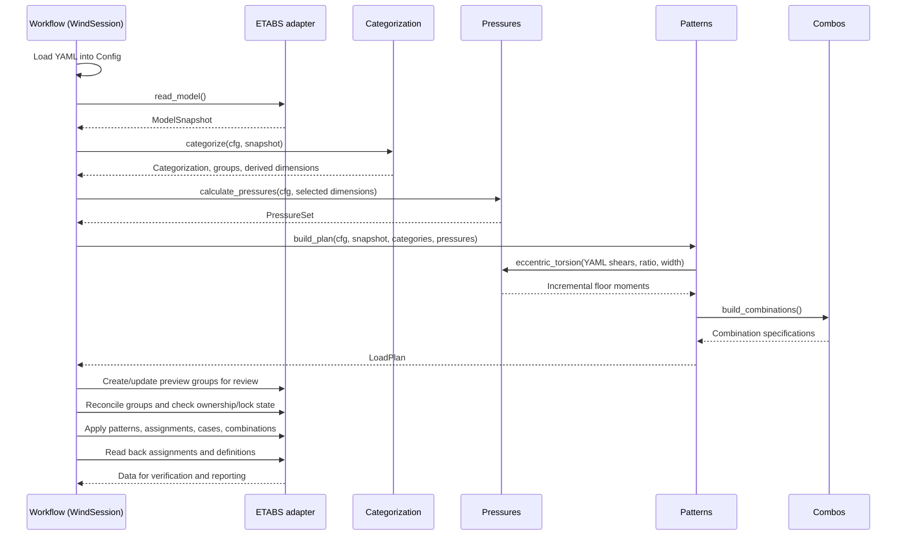

# Module interfaces and overall specification

## Module responsibilities

- **Pressure Module** (`pressures/`)
  - Calculates wind pressures, equipment forces, and platform line loads from wind inputs and
    building dimensions supplied by the workflow.
  - Uses either dimensions derived from ETABS geometry by Categorization or dimensions from YAML.
    It does not retrieve geometry from ETABS itself.
  - Returns calculation results for Patterns and provides a pure eccentric-torsion calculation helper.
- **Categorization Module** (`categorization/`)
  - Examines a model snapshot and classifies shells by building feature, elevation band, and
    windward, leeward, or side role for each wind direction.
  - Covers main walls, parapets, and penthouse bodies/parapets; configured platform frames and
    equipment support joints are also categorized.
  - Derives the main-building rectangular envelope and creates preview-group specifications.
    The workflow creates the corresponding groups in ETABS through the adapter.
- **Patterns Module** (`patterns/`)
  - Combines calculated pressures and group specifications into pattern definitions, analysis
    case definitions, and object-level load assignments.
  - Uses cumulative story shears supplied in YAML to calculate eccentric floor moments through
    the Pressure module's helper and includes them in directional eccentric patterns.
  - Includes combination specifications in the load plan. The workflow applies the plan to ETABS
    through the adapter.
  - Retrieving story forces from ETABS analysis cases without eccentricity is planned, but is
    not implemented.
- **Combos Module** (`combinations/`)
  - Defines provisional W1-W4 wind combinations using the generated wind case names, plus one
    envelope per family.
  - Returns specifications; the workflow and adapter create the combinations in ETABS after
    defining the referenced cases.

This document describes current module boundaries and interactions. Planned behavior is identified
explicitly. Scope is horizontal MWFRS for one principal rectangular building, using ASCE 7-10.
Engineering assumptions and validation status are maintained in [engineering basis](engineering_basis.md);
unsupported behavior is maintained in [limitations](limitations.md).

## Supporting modules and boundaries

| Module | Responsibility |
| --- | --- |
| [`models.py`](../src/air_apparent/models.py) | Shared dataclasses, directions, categories, and stable naming helpers. |
| [`config.py`](../src/air_apparent/config.py) | Loads and validates authoritative YAML inputs; exposes the effective configuration. |
| [`etabs/`](../src/air_apparent/etabs/adapter.py) | Adapter protocol and optional live COM implementation for model reads, groups, definitions, assignments, and read-back. |
| [`etabs/fake_adapter.py`](../src/air_apparent/etabs/fake_adapter.py) | In-memory adapter for offline operation and integration tests. |
| [`workflow.py`](../src/air_apparent/workflow.py) | `WindSession` coordinates modules, holds state, manages previews and ownership, applies the plan, and verifies read-back. |
| [`demo.py`](../src/air_apparent/demo.py) | Builds a synthetic model snapshot from the configuration for offline use. |
| [`reporting.py`](../src/air_apparent/reporting.py) | Exports effective YAML, assignment-plan JSON/CSV, and an HTML report from session state. |
| [`ui.py`](../src/air_apparent/ui.py) | Tkinter controls for configuration, connection, inspection, calculation, preview review, application, and export. |

The four core modules operate on Python data without calling the GUI or live ETABS. They exchange
shared dataclasses from `models.py`, with these direct dependencies: Patterns calls Categorization's
conflict check, Pressures' eccentricity helper, and Combos' definition builder.
`WindSession` owns the adapter calls that read the model and write the resulting specifications.

## End-to-end workflow



1. **Load inputs and connect.** Load YAML, then attach to an existing ETABS instance or use the
   offline demo. The live connector requires an explicit process ID when multiple instances exist.
2. **Read and categorize.** Read shells, frames, joints, stories, existing groups, and load-definition
   names. Categorization derives the envelope, classifies objects, and builds group specifications.
   Existing ETABS groups do not determine the categories.
3. **Calculate pressures.** Select active dimensions as described below, then calculate a
   `PressureSet`. Wind parameters, pressure evaluation heights, feature definitions, and mappings
   remain configuration inputs.
4. **Build the load plan.** Patterns resolves group result IDs to numeric pressures, builds shell,
   frame, and joint assignments, adds eccentric moments when shears are supplied, and includes
   patterns, cases, combinations, groups, and diagnostics in a `LoadPlan`.
5. **Create and review preview groups.** The workflow writes group membership without assigning
   loads. The user can select groups in ETABS to inspect their members. Creating groups does not
   establish that the load plan is free of errors.
6. **Apply.** Require a plan, valid previews, no error-level plan diagnostics, matching group
   membership, and no conflicts with unrelated definitions. Define patterns, clear stale owned
   assignments, assign loads, define cases, then define linear combinations before envelopes.
7. **Verify and export.** Read back assignment counts and values, pattern presence, case and
   combination terms/factors, and calculated load resultants. Export the session's inputs, plan,
   diagnostics, and available verification rows.

### Dimension selection

`WindSession.calculate()` selects dimensions according to `geometry.plan_dimensions_source`:

| Source | Active dimensions | Role of YAML dimensions |
| --- | --- | --- |
| `etabs` | `Categorization.derived_dims`, obtained from the shell envelope | Required comparison values; discrepancies are reported. Missing derived dimensions raise an error. |
| `yaml` | `Config.geometry.x_wind` and `y_wind` | Active dimensions used by the pressure calculation. |

`PlanDims.parallel_l` is the length parallel to wind; `perpendicular_b` is the width perpendicular
to wind. The selected dimensions are retained in `PressureSet.dims` and used again for eccentricity.
Calling `calculate_pressures(cfg)` directly defaults to YAML dimensions, even if the configuration
selects `etabs`; a caller outside `WindSession` must supply derived dimensions explicitly.

### Eccentric-load path

The current implementation reads `loading.story_shears_kip[direction]` in its YAML mapping order,
which must run from the top story downward. It does not run analysis or retrieve ETABS results.
For each direction, Patterns calls `pressures.eccentric_torsion()` with those cumulative shears,
the configured eccentricity ratio, and the perpendicular building dimension:

```text
eccentricity e = ratio * perpendicular_b
target torsion T(story) = cumulative shear V(story) * e
applied floor moment = T(story) - T(story above)
```

The helper rejects cumulative shears that decrease going downward. Patterns creates global-Z
joint-moment assignments at each story's `reference_joint`. Missing shears produce a warning and
leave that direction's eccentric pattern empty; a missing story/reference joint produces an error.
Both signs of eccentric torsion are introduced through combination factors.

The offline demo supplies reference joints. The current live reader creates stories with names and
elevations but does not populate their diaphragm or reference-joint fields. Live eccentric loading
therefore still needs reference-joint retrieval/mapping as well as the planned ETABS story-force path.

## Interface contracts

| Module / entry point | Input | Output |
| --- | --- | --- |
| `config.load_config(path)` | YAML file | Validated `Config`, or `ConfigError` with field-path messages. |
| `adapter.read_model()` | Connected model or fake-adapter state | `ModelSnapshot` containing geometry, stories, groups, and existing definition names. |
| `categorization.categorize(cfg, snap)` | `Config`, `ModelSnapshot` | `Categorization`: object categories, envelope, derived dimensions, `GroupSpec` list, diagnostics. |
| `pressures.calculate_pressures(cfg, dims=None)` | `Config`, optional `dict[str, PlanDims]` keyed by `X`/`Y` | `PressureSet`: edition, active dimensions, results keyed by ID, and separate checks. |
| `pressures.eccentric_torsion(story_shears, ratio, perpendicular_dim_ft, shear_source)` | Ordered cumulative story shears and eccentricity inputs | `list[EccStory]` with eccentricities, target torsions, applied floor moments, and provenance. |
| `patterns.pattern_specs()` / `case_specs()` | No arguments | `list[PatternSpec]` / `list[CaseSpec]`. |
| `patterns.build_plan(cfg, snap, cats, ps)` | Configuration, snapshot, categorization, pressures | `LoadPlan` containing definitions, assignments, groups, diagnostics, and notes. |
| `combinations.build_combinations()` | No arguments; uses the shared case naming convention | `list[CombinationSpec]` for W1-W4 and their envelopes. |

A `CalcResult` carries an ID, description, value, units, reference, input values, notes, status, and
an optional source-cell field. The pressure calculator does not currently fill the source-cell
field; workbook benchmark fixtures maintain that provenance. A `GroupSpec` links members to a
destination pattern, result ID, and assignment sign. Patterns uses those specifications to generate
individual object assignments; it does not apply a pressure to an ETABS group by name.

### Shared identifiers, units, and signs

- Objects use stable references: `A:<shell>`, `F:<frame>`, and `P:<joint>`.
- Result IDs connect calculation outputs to groups and assignments, for example `WALL_WW_L2_MIN`,
  `WALL_LW_X_MAX`, `WALL_SIDE_MIN`, `PARAPET_TYP_WW`, `PH_PH1_NET`, `PLAT_PL1_LINE`, and
  `EQ_CHILLER01_FX`.
- Preview-group names start with `AA_PREVIEW_` and never contain numerical pressures. Names encode
  applicable feature, band, direction, role, branch, and local-axis flip tokens.
- Directions `+X`, `-X`, `+Y`, and `-Y` indicate where the wind acts toward. A face with outward
  normal opposite that direction is windward; parallel is leeward; perpendicular is side.
- Geometry uses ft; calculation pressures use psf; platform line loads use plf; equipment forces
  use kip. Assignments use kip/ft2, kip/ft, kip, or kip-ft, with the specified local/global direction.
- Code pressure is positive toward the surface. Shell assignments convert it to local-axis-3 sign
  and divide psf by 1000. Mechanical forces use global X/Y and eccentric moments use global Z.

## Generated patterns, cases, and combinations

| Definition | Convention | Count |
| --- | --- | --- |
| Directional patterns | `W_Wall_d`, `W_Parapet_d`, `W_PH_d`, `W_Ecc_d` for each direction `d` | 16 |
| Reversible mechanical patterns | `W_Mech_X`, `W_Mech_Y` | 2 |
| Directional cases | One case per directional pattern with factor 1.0 | 16 |
| Mechanical cases | `W_Mech_+X`, `W_Mech_-X`, `W_Mech_+Y`, `W_Mech_-Y`, with factors +1/-1 on the corresponding mechanical pattern | 4 |

Totals are **18 patterns and 20 cases**. There are no additional cases named `W_Mech_X` or
`W_Mech_Y` in `case_specs()`. Penthouse net body pressure goes only on the windward body face;
penthouse side shells and parapet side shells receive side pressure under `W_Wall_d`.
Mechanical equipment forces are shared equally among four configured joints, with no overturning
moments; platform loads are uniform frame line loads.

For combination notation, `W_d` is the sum of the Wall, Parapet, PH, and signed Mech **cases** for
direction `d`; `E_d` is its eccentric case. These sums are notation, not additional generated cases.

| Family | Linear definition | Linear count |
| --- | --- | --- |
| W1 | `W_d` for each direction | 4 |
| W2 | `0.75 * (W_d +/- E_d)` | 8 |
| W3 | `0.75 * (W_dx + W_dy)` for each X/Y direction pair | 4 |
| W4 | `0.5625 * (W_dx + W_dy +/- E_dx +/- E_dy)`, with independent eccentric signs | 16 |

Each family also has a `Wn_ENV` envelope referencing its linear combinations: **32 linear plus
4 envelope combinations** in total. All W1-W4 definitions and eccentric loads are provisional.
Gravity-plus-wind design combinations are outside the current scope.

## Session state, ownership, and failures

Reloading configuration clears categories, pressures, the plan, preview validity, and stored apply/
verification results. Changing the adapter also clears the snapshot. Rereading the model clears
dependent state; recategorizing clears pressures, the plan, and preview validity. Recalculating
pressures clears the plan. The GUI checks for YAML file changes before its operations; scripted
callers must reload inputs and reread model geometry when they change. Group reconciliation before
apply checks membership drift, not arbitrary geometry changes since the snapshot was read.

The ownership manifest records generated groups, patterns, cases, combinations, and assignment keys.
The live adapter stores it beside the model as `<model filename>.air_apparent.json`; the fake adapter
keeps it in memory. A matching name alone does not establish ownership. Preview creation and apply
reject collisions with unrelated model content. Obsolete owned preview groups are removed when
previews are rebuilt; obsolete owned assignments are cleared during apply. The workflow does not
delete obsolete pattern, case, or combination definitions.

Adapter assignment methods have replace semantics to avoid accumulating loads on reapply. Offline
tests cover this behavior; live ETABS behavior remains unverified. A locked model blocks apply
unless unlocking is explicitly enabled, because unlocking discards analysis results. An
`AdapterError` during the apply write loop stops subsequent writes and returns partial-apply counts;
changes already made are not rolled back.

Diagnostics have `error`, `warning`, or `info` severity. Error-level plan diagnostics block apply;
warnings such as unresolved objects or missing eccentric shears do not automatically block it.
Read-back verification compares the plan with stored definitions/loads and calculated resultants,
not with ETABS analysis story forces or structural adequacy.

## YAML configuration schema (version 1)

YAML is the authoritative source of wind inputs. Loading uses a `SafeLoader` subclass that rejects
duplicate keys. Validation checks recognized keys, types, allowed choices, configured numeric
bounds, linked dimensions, and mappings, with field paths such as `wind.exposure_category`.

Required sections and fields:

- `schema_version: 1`, `code_edition`, and `units: US`. Pressure calculation currently supports only
  `ASCE 7-10`; other editions raise `UnsupportedEditionError` at calculation time.
- `wind`: risk category, basic wind speed, directionality factor, exposure, topographic factor,
  gust factor, enclosure classification, absolute internal-pressure coefficient, and mean roof
  height above grade.
- `geometry`: `target: entire_model`, `wind_axes: global_xy`, `plan_dimensions_source: etabs|yaml`,
  and `plan_dimensions_ft.{x_wind,y_wind}.{parallel_l,perpendicular_b}`.
- `loading`: `wall_pressure_branch_by_direction` for all four directions, `eccentricity_ratio`,
  and `mechanical_patterns: reversible_xy`.
- `grade`: `datum_model_elevation_ft` and `roof_planes` with IDs and model elevations. The first
  roof plane supplies the main roof used by categorization; callers must provide it.
- `story_bands`: a non-empty list with IDs, bottom/top model elevations, and pressure evaluation
  heights above grade. Bands must have positive height and may not overlap.

Linked workbook cells are `Chp 26!C21 = B22` and `C22 = B21`, so `y_wind.parallel_l` must equal
`x_wind.perpendicular_b` and `y_wind.perpendicular_b` must equal `x_wind.parallel_l` (validated).
Model elevations and heights above grade are distinct inputs.

Optional sections are `parapets.types`, `penthouses`, `rooftop.net_force_coefficient_cf`, `platforms`,
`equipment`, `overrides` (shell name to category), and `loading.story_shears_kip`. Equipment requires
exactly four support-joint names with no repeated mappings; Categorization checks configured joint
and frame existence against the snapshot. The rooftop coefficient defaults to 1.3.
See the [input template](../templates/wind_inputs.yaml) and
[reference example](../examples/reference_sample.yaml) for field-level examples.

## Current implementation and planned extensions

| Capability | Current repository behavior |
| --- | --- |
| Geometry and group creation | Adapter reads object geometry; Categorization builds specifications; workflow writes preview groups. |
| Grid-based grouping / side relative to building center of gravity | Proposed in the categorization spec; no grid-definition or center-of-gravity retrieval is implemented. Current rules use envelope edges and outward normals. |
| ETABS story-force retrieval for cases without eccentricity | Planned. Neither the adapter protocol nor live implementation exposes analysis execution or story-force retrieval. Current shears come from YAML. |
| Diaphragm reference joints | Available in the demo snapshot; not populated by the live model reader. |
| Stair projections | Override-based category and inspection group exist; no wind-load treatment is defined. |
| Engineering and live validation | Workbook reproduction and fake-adapter tests exist; independent engineering review and live ETABS verification remain pending. |

The intended ETABS-results extension would apply the loads without eccentricity, obtain fresh
analysis results for the appropriate loading states, retrieve story shears and diaphragm reference
points through the adapter, then rebuild/apply eccentric assignments. Case/result selection,
freshness checks, and handling multiple diaphragms still need defined contracts before that path
can replace the YAML source.

## Offline usage and verification

```python
from air_apparent.workflow import WindSession

session = WindSession()
session.load_config("examples/reference_sample.yaml")
session.use_offline_demo()
session.read_model()
session.calculate()  # Categorizes first and selects dimensions from the configured source.
session.build_plan()
preview_diagnostics = session.create_preview_groups()
assert not any(d.level == "error" for d in preview_diagnostics)
result = session.apply()  # Writes to FakeAdapter, not a live ETABS model.
assert result.ok, result.message
assert all(row.ok for row in session.verify())
```

Shared fixtures in [`tests/conftest.py`](../tests/conftest.py) provide `cfg`, `snap`, and `session`
using the reference configuration and synthetic model. Existing tests cover pressure benchmarks,
categorization, pattern/case definitions, combination references/factors, dimension selection,
preview conflicts/drift, repeat application, partial failures, and read-back/export behavior.

## Related specifications

- [Categorization specification](spec_categorization.md): proposed shell-group distinctions and
  grouping workflow. Its grid/center-based descriptions extend beyond the current implementation.
- [Engineering basis](engineering_basis.md): equations, workbook correspondence, and engineering
  validation status.
- [ETABS setup](etabs_setup.md): live-integration requirements and verification checklist.
- [Limitations](limitations.md): unsupported features and known gaps.

Detailed Pressure, Patterns, and Combos specification documents are not yet present. Their future
specs should expand module-internal rules and reference this document for shared contracts and
cross-module sequencing.
